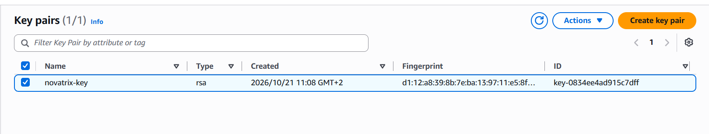
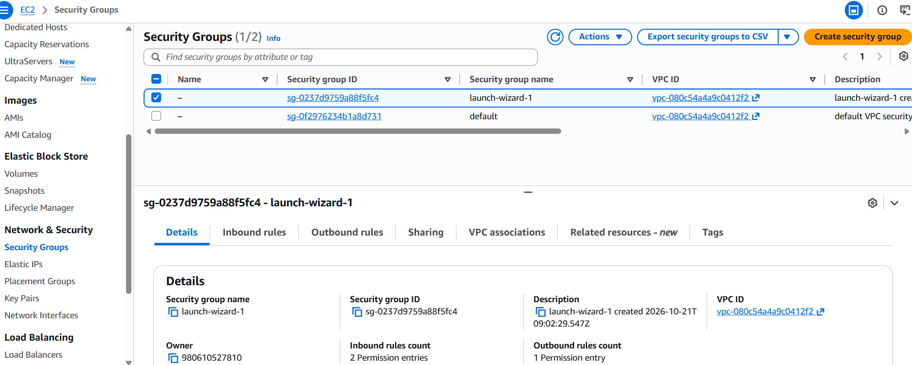
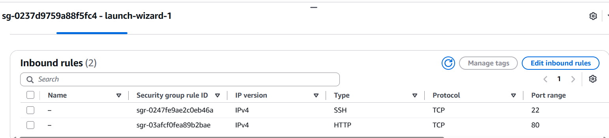
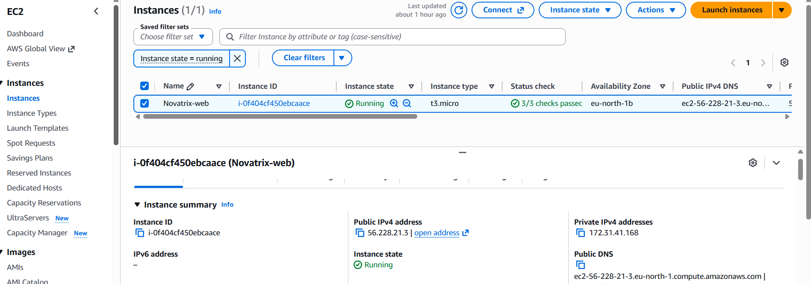
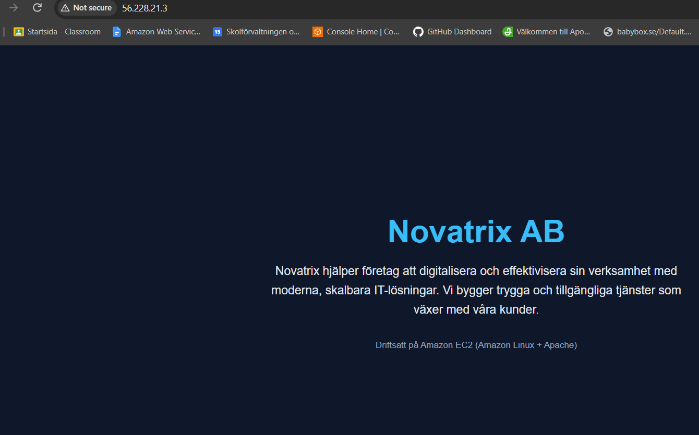
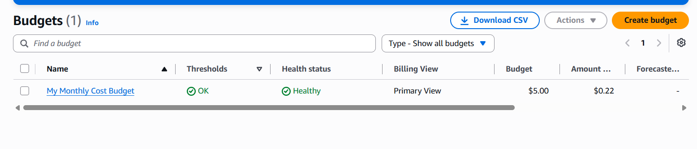
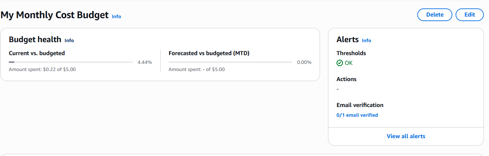
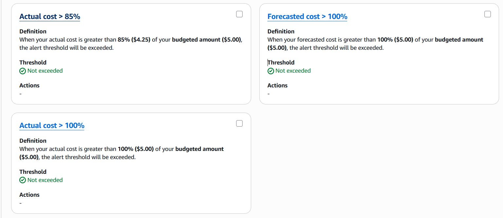
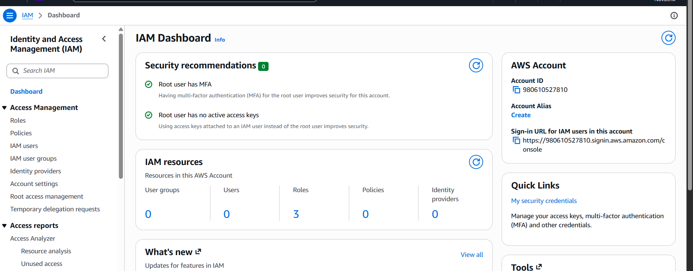

# Vecka 42 – EC2, Apache och Novatrix webbsida

Luna Lindström, AWS-MOV25

[Tillbaka till översikten](../README.md)

Den här veckan har jag satt upp en virtuell server i AWS åt Novatrix och lagt upp en enkel webbsida på den. Sidan går att nå på http://56.228.21.3.

## Innehåll

1. [Kursrepo på GitHub](#delmoment-1--kursrepo-på-github)
2. [Starta en EC2-instans](#delmoment-2--starta-en-ec2-instans)
3. [Ansluta med SSH och installera webbserver](#delmoment-3--ansluta-med-ssh-och-installera-webbserver)
4. [Lägga upp webbsidan](#delmoment-4--lägga-upp-webbsidan)
5. [Verifiera](#delmoment-5--verifiera)
6. [Kostnadskontroll](#delmoment-6--kostnadskontroll)

## Delmoment 1 – Kursrepo på GitHub

Jag skapade ett publikt repo som heter AWS-MOV25. Det är samma upplägg som jag hade i Azure-kursen, med en mapp per vecka och en README på startsidan med namn och innehåll.

Repo: https://github.com/96lonsor/AWS-MOV25


## Delmoment 2 – Starta en EC2-instans

Jag startade instansen via "Launch instance" i EC2-konsolen med de här inställningarna:

| Inställning    | Värde                                  |
|----------------|----------------------------------------|
| Namn           | Novatrix-web                           |
| AMI            | Amazon Linux 2023                      |
| Instanstyp     | t3.micro                               |
| Key pair       | novatrix-key (RSA, .pem)               |
| Security group | launch-wizard-1                        |
| Region         | eu-north-1 (Stockholm), zon eu-north-1b |
| Publik IP      | 56.228.21.3                            |

Jag valde t3.micro eftersom den ingår i free tier och räcker gott för en enkel webbsida. Behövs mer kraft senare, när WordPress kommer in, går det att byta upp sig. Stockholm valde jag för att det ligger närmast.

I security group öppnade jag två portar:

| Typ  | Port | Källa     | Varför                        |
|------|------|-----------|-------------------------------|
| SSH  | 22   | Min IP    | Så att bara jag kan logga in  |
| HTTP | 80   | 0.0.0.0/0 | Så att alla kan se webbsidan  |





Instansen kom igång och klarade alla statuskontroller (3/3).



## Delmoment 3 – Ansluta med SSH och installera webbserver

Nyckelfilen sparade jag i min .ssh-mapp. SSH vägrar använda en nyckel som andra användare kan läsa, så först tog jag bort de ärvda rättigheterna och gav bara mig själv läsrätt:

```powershell
cd $HOME\.ssh
icacls .\novatrix-key.pem /inheritance:r
icacls .\novatrix-key.pem /grant:r "$($env:USERNAME):R"
ssh -i .\novatrix-key.pem ec2-user@56.228.21.3
```

Första gången frågar SSH om man litar på servern, och där svarade jag yes. Utdrag från terminalen:

```text
The authenticity of host '56.228.21.3 (56.228.21.3)' can't be established.
Are you sure you want to continue connecting (yes/no/[fingerprint])? yes
Warning: Permanently added '56.228.21.3' (ED25519) to the list of known hosts.
   ,     #_
   ~\_  ####_        Amazon Linux 2023
  ~~  \_#####\
  ~~     \###|
  ~~       \#/ ___   https://aws.amazon.com/linux/amazon-linux-2023
   ~~       V~' '->
    ~~~         /
      ~~._.   _/
         _/ _/
       _/m/'
[ec2-user@ip-172-31-41-168 ~]$
```

Prompten slutar med `$` och visar ec2-user, så jag är inloggad på servern.

Väl inne installerade jag Apache (httpd) och såg till att den startar automatiskt om servern startas om. Kommandona finns också i [kod/install-webserver.sh](kod/install-webserver.sh).

```bash
sudo dnf update -y
sudo dnf install -y httpd
sudo systemctl start httpd
sudo systemctl enable httpd
sudo systemctl status httpd --no-pager
```

Utdrag från statuskommandot:

```text
● httpd.service - The Apache HTTP Server
     Loaded: loaded (/usr/lib/systemd/system/httpd.service; enabled; preset: disabled)
     Active: active (running) since Thu 2026-10-22 09:30:41 UTC; 517ms ago
   Main PID: 44864 (httpd)
     Status: "Started, listening on: port 80"
```

Active (running) betyder att Apache är igång, enabled att den startar automatiskt efter en omstart, och den lyssnar på port 80.

## Delmoment 4 – Lägga upp webbsidan

Apache visar det som ligger i /var/www/html/. Innan jag lagt dit något fick man bara felkod 403 när man gick till IP-adressen.

Jag skapade index.html direkt på servern med tee. Hela HTML-koden finns i [kod/index.html](kod/index.html).

```bash
sudo tee /var/www/html/index.html > /dev/null <<'EOF'
<!DOCTYPE html>
<html lang="sv">
  ... (innehållet från kod/index.html) ...
</html>
EOF
```

Sedan kollade jag att filen fanns och att Apache skickar ut den:

```bash
ls -l /var/www/html/
curl http://localhost
```

Utdrag från terminalen:

```text
total 4
-rw-r--r--. 1 root root 991 Oct 22 09:35 index.html
<!DOCTYPE html>
<html lang="sv">
<head>
  <meta charset="UTF-8">
  ...
    <h1>Novatrix AB</h1>
  ...
</html>
```

Filen finns och curl får tillbaka hela sidan, så Apache skickar ut den.

## Delmoment 5 – Verifiera

När jag går till http://56.228.21.3 i webbläsaren syns Novatrix sida. Webbläsaren skriver "Not secure", men det är för att sidan körs på vanlig HTTP utan certifikat, inte för att något är fel.



## Delmoment 6 – Kostnadskontroll

I AWS Budgets skapade jag en månadsbudget på 5 USD som skickar mejl till mig. Det finns larm både på faktisk kostnad och på prognostiserad kostnad. Det prognostiserade larmet är bra eftersom det säger till innan pengarna faktiskt är slut.

| Larm            | Gräns  | Belopp   |
|-----------------|--------|----------|
| Faktisk kostnad | 85 %   | 4,25 USD |
| Faktisk kostnad | 100 %  | 5,00 USD |
| Prognos         | 100 %  | 5,00 USD |

Hittills i månaden har det kostat 0,22 USD och inget larm har gått.





## Säkerhet på kontot

Jag har MFA på root-kontot och inga access keys kopplade till det.



## Städning efter labben

När jag är klar för dagen stoppar jag instansen via Instance state → Stop. Stop stänger av servern men den finns kvar och kan startas igen. Terminate hade raderat den för gott, och det vill jag inte eftersom vi bygger vidare på samma miljö nästa vecka.

En stoppad instans kostar inget för datorkraften, men disken (EBS) finns kvar och räknas fortfarande. Den publika IP-adressen kan bli en ny nästa gång jag startar instansen, så 56.228.21.3 gäller bara just nu. Skärmbilden på sidan visar att den fungerade.

Key pair (novatrix-key) och security group (launch-wizard-1) behåller jag till nästa vecka.

## Reflektion

Det mesta gick smidigt. Det enda som strulade var första SSH-försöket, där jag råkade få med en platshållare i stället för den riktiga IP-adressen. Det var lätt att se i felmeddelandet. Det var också bra att testa sidan med curl på servern först, så att jag visste att Apache fungerade innan jag kollade utifrån.

Servern är grunden för WordPress-sidan som vi bygger vidare på under kursen. Nästa steg blir nätverk, databas och lagring.
