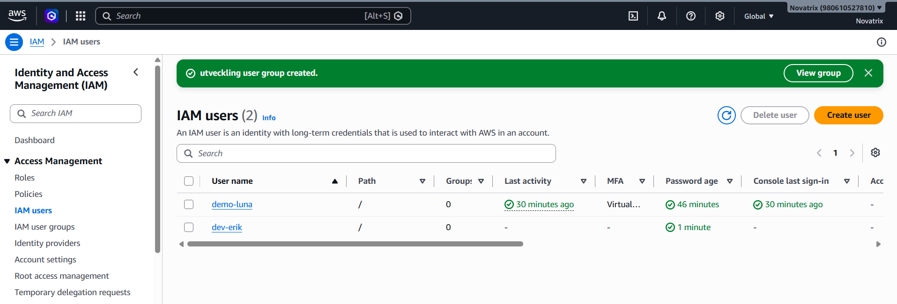
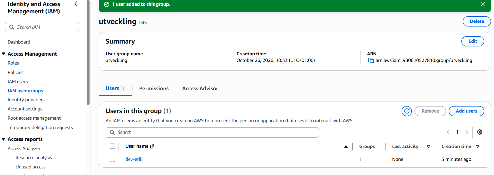
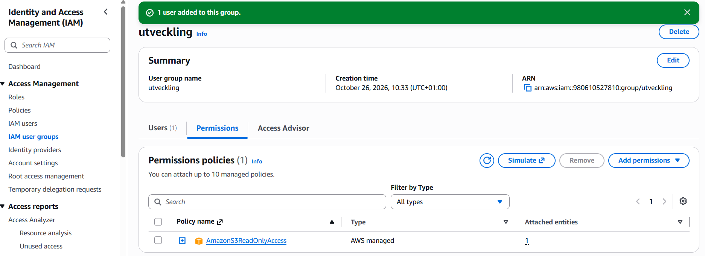
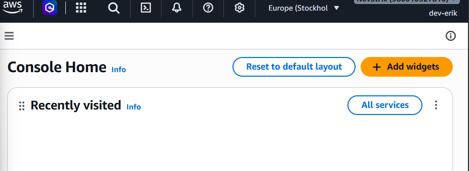
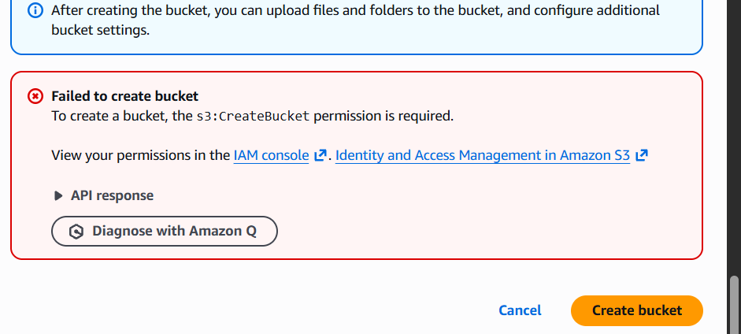
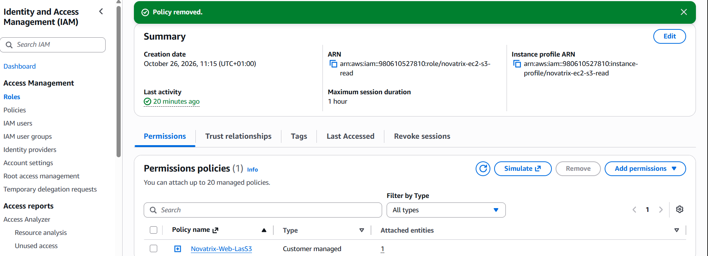
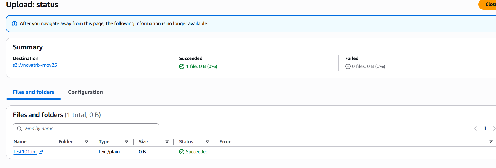
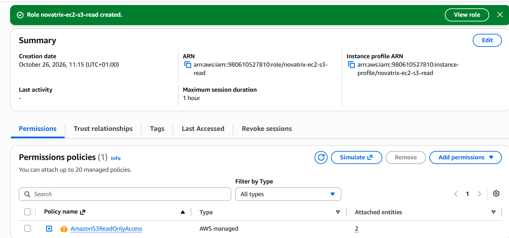
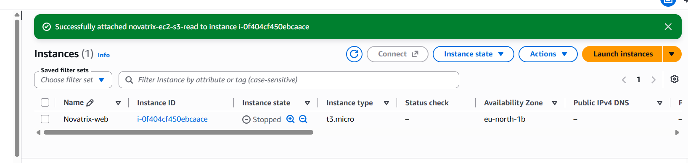

# Vecka 43 – IAM och identitet

Luna Lindström, AWS-MOV25

[Tillbaka till översikten](../README.md)

Den här veckan har jag jobbat med IAM, alltså vem och vad som får göra saker i Novatrix AWS-konto. Personalen får användare som ligger i grupper, och webbservern får en roll så att den kan läsa från S3 utan nycklar. Målet har varit least privilege, att varje användare och tjänst bara får göra det den behöver.

Repo: https://github.com/96lonsor/AWS-MOV25

## Innehåll

1. [Repo](#delmoment-1--repo)
2. [Användare och grupper](#delmoment-2--användare-och-grupper)
3. [Policies enligt least privilege](#delmoment-3--policies-enligt-least-privilege)
4. [Behörigheter mellan tjänster](#delmoment-4--behörigheter-mellan-tjänster)
5. [Verifiera](#delmoment-5--verifiera)
6. [Reflektion](#reflektion)

## Delmoment 1 – Repo

Jag lade till mappen V43 på samma sätt som förra veckan, med en README, en mapp för bilder och en för kod. Veckan finns också med i översikten på startsidan.

## Delmoment 2 – Användare och grupper

### Root-kontot

Det första jag gjorde var att skydda root-kontot. Det har MFA och jag använder det inte längre till vanligt arbete. Root kan göra allt i kontot och går inte att begränsa med policies, så det får bli ett nödkonto ("break glass") som jag bara tar fram om något går riktigt fel.

I stället skapade jag en egen administratörsanvändare, demo-luna, som också har MFA. Det är den jag loggar in med nu.



### Gruppen utveckling

Sedan skapade jag gruppen utveckling och användaren dev-erik, och lade in dev-erik i gruppen. Rättigheterna sätter jag på gruppen och inte direkt på användaren. Om Novatrix anställer en till utvecklare räcker det att lägga in den personen i gruppen, och om någon slutar tar man bara bort personen ur gruppen.

Gruppen fick AWS färdiga policy AmazonS3ReadOnlyAccess.




För att testa loggade jag in som dev-erik och försökte skapa en bucket. Det gick inte, eftersom gruppen bara får läsa.




Gruppen fungerade alltså. Men AmazonS3ReadOnlyAccess gäller alla buckets i hela kontot, inte bara Novatrix. Det är mer än en utvecklare behöver, och det är samma problem som jag löser för webbservern i delmoment 3.

## Delmoment 3 – Policies enligt least privilege

Webbservern fick först också AmazonS3ReadOnlyAccess (se delmoment 4). Det fungerade, men då kan servern läsa alla buckets i kontot, fast den bara behöver en. Därför skrev jag en egen policy, Novatrix-Web-LasS3, under IAM → Policies → Create policy:

```json
{
  "Version": "2012-10-17",
  "Statement": [
    {
      "Sid": "ListaBucketen",
      "Effect": "Allow",
      "Action": "s3:ListBucket",
      "Resource": "arn:aws:s3:::novatrix-mov25"
    },
    {
      "Sid": "LasFiler",
      "Effect": "Allow",
      "Action": "s3:GetObject",
      "Resource": "arn:aws:s3:::novatrix-mov25/*"
    }
  ]
}
```

Policyn ger två rättigheter. ListBucket behövs för att se vilka filer som finns i bucketen, och GetObject för att kunna hämta dem. ListBucket gäller själva bucketen och GetObject gäller filerna i den, därför står bucketen med två gånger, en gång utan och en gång med `/*` på slutet.

Allt som inte står i policyn är nekat. Servern kan alltså inte ladda upp, radera eller se några andra buckets.

Jag lade till policyn på rollen och tog bort AmazonS3ReadOnlyAccess.



## Delmoment 4 – Behörigheter mellan tjänster

### Roll eller användare

En användare är en fast identitet med egna nycklar som gäller länge. En roll är en tillfällig identitet som man tar på sig när den behövs. Användare passar för personer och roller passar för tjänster.

Nycklarna en roll ger gäller bara en kort stund och byts ut automatiskt. Då finns det inga hemligheter som kan läcka eller som någon glömmer att byta. Därför är roller det säkra sättet att låta en tjänst nå en annan.

### Nycklar i koden

Det kan vara frestande att bara klistra in en åtkomstnyckel i koden, till exempel i ett skript på servern. Men då hamnar nyckeln lätt på GitHub, i loggar eller syns på skärmen. En nyckel som läcker kan missbrukas i månader, eftersom den fungerar ända tills någon kommer ihåg att byta den.

Mitt repo är publikt, så en nyckel som hamnar här kan vem som helst hitta. Därför finns det inga nycklar alls i repot, servern använder en roll i stället. I .gitignore har jag också lagt in filtyper som inte ska kunna committas av misstag:

```text
*.pem
*.ppk
*.key
.aws/
credentials
*accessKeys.csv
*credentials.csv
.env
```

När man skapar en access key i konsolen kan man ladda ner den som en csv-fil, därför finns de två csv-raderna med.

Innan inlämningen sökte jag igenom hela git-historiken efter något som liknar AWS-nycklar, och hittade inget:

```bash
git log --all -p | grep -nE "AKIA[0-9A-Z]{16}|aws_secret_access_key|PRIVATE KEY"
```

Skulle en nyckel ändå läcka räcker det inte att ta bort den från repot, den finns kvar i historiken. Då måste den stängas av i IAM direkt.

### Webbservern ska läsa från S3

Novatrix webbserver ska kunna läsa filer från en S3-bucket. Det dåliga sättet vore att lägga en åtkomstnyckel på servern. Det bra sättet är att ge EC2-instansen en roll som får läsa från bucketen.

En roll har två delar. Trust policyn säger vem som får använda rollen, här bara EC2. Permissions policyn säger vad rollen får göra, här bara läsa i en bucket. Trust policyn för en EC2-roll ser ut så här:

```json
{
  "Effect": "Allow",
  "Principal": { "Service": "ec2.amazonaws.com" },
  "Action": "sts:AssumeRole"
}
```

När rollen är kopplad till instansen hämtar AWS CLI tillfälliga nycklar från instansen själv. Det finns inga nycklar sparade på disken som någon kan komma åt.

### Bucketen

Jag skapade bucketen novatrix-mov25 i Stockholm (eu-north-1) och behöll standardinställningarna, så den är inte publik. Webbsidan visas ju via Apache på servern, så bucketen behöver inte vara öppen för andra. Som test laddade jag upp en tom fil, test101.txt.



### Rollen

Under IAM → Roles skapade jag rollen novatrix-ec2-s3-read. Jag valde EC2 som tjänst, och då skapade AWS trust policyn åt mig. Den fick också en instansprofil med samma namn, som är det som gör att rollen går att koppla till en EC2-instans.

Först fick rollen AmazonS3ReadOnlyAccess. Den byttes senare mot min egen policy, se delmoment 3.



### Koppla rollen till servern

Rollen kopplade jag till webbservern från v42 via EC2 → Novatrix-web → Actions → Security → Modify IAM role. Instansen var stoppad, men det gick bra ändå.



Skriptet [kod/sync-site.sh](kod/sync-site.sh) kan köras på servern för att hämta filer från bucketen till Apache. Det har inga inloggningsuppgifter i sig, bara `aws s3 sync`.

## Delmoment 5 – Verifiera

Jag startade servern och loggade in med SSH. Först fick jag timeout, eftersom min IP-adress hade ändrats sedan förra veckan och security group bara släppte in den gamla. När jag ändrade SSH-regeln till My IP kom jag in.

Inga nycklar är inlagda på servern, så om det går att läsa från S3 är det rollen som gör det. Först kollade jag vem servern är inloggad som:

```bash
aws sts get-caller-identity
```

```text
{
    "UserId": "AROA6IUHRGJBFT2UVO222:i-0f404cf450ebcaace",
    "Account": "980610527810",
    "Arn": "arn:aws:sts::980610527810:assumed-role/novatrix-ec2-s3-read/i-0f404cf450ebcaace"
}
```

Servern använder rollen novatrix-ec2-s3-read, och sist står instansens id.

Sedan listade jag bucketen och hämtade testfilen:

```text
[ec2-user@ip-172-31-41-168 ~]$ aws s3 ls s3://novatrix-mov25
2026-10-26 10:10:51          0 test101.txt
[ec2-user@ip-172-31-41-168 ~]$ aws s3 cp s3://novatrix-mov25/test101.txt /tmp/
download: s3://novatrix-mov25/test101.txt to ../../tmp/test101.txt
[ec2-user@ip-172-31-41-168 ~]$ ls -l /tmp/test101.txt
-rw-r--r--. 1 ec2-user ec2-user 0 Oct 26 10:10 /tmp/test101.txt
```

Det fungerade utan att jag angav några nycklar, så rollen fungerar.

Efter det provade jag att ladda upp en fil och att radera testfilen, vilket rollen inte ska få göra:

```text
[ec2-user@ip-172-31-41-168 ~]$ echo hej > /tmp/hej.txt
[ec2-user@ip-172-31-41-168 ~]$ aws s3 cp /tmp/hej.txt s3://novatrix-mov25/hej.txt
upload failed: ../../tmp/hej.txt to s3://novatrix-mov25/hej.txt An error occurred
(AccessDenied) when calling the PutObject operation: User: arn:aws:sts::980610527810:
assumed-role/novatrix-ec2-s3-read/i-0f404cf450ebcaace is not authorized to perform:
s3:PutObject on resource: "arn:aws:s3:::novatrix-mov25/hej.txt" because no
identity-based policy allows the s3:PutObject action
[ec2-user@ip-172-31-41-168 ~]$ aws s3 rm s3://novatrix-mov25/test101.txt
delete failed: s3://novatrix-mov25/test101.txt An error occurred (AccessDenied) when
calling the DeleteObject operation: User: arn:aws:sts::980610527810:assumed-role/
novatrix-ec2-s3-read/i-0f404cf450ebcaace is not authorized to perform:
s3:DeleteObject on resource: "arn:aws:s3:::novatrix-mov25/test101.txt" because no
identity-based policy allows the s3:DeleteObject action
```

Båda nekades. Felet säger "no identity-based policy allows", alltså att ingen policy på rollen tillåter det. I IAM är allt nekat som inte uttryckligen är tillåtet.

### Före och efter egen policy

Med AmazonS3ReadOnlyAccess kunde servern lista alla buckets i kontot. Här syns bara en, men det är för att det bara finns en:

```text
[ec2-user@ip-172-31-41-168 ~]$ aws s3 ls
2026-10-26 10:09:59 novatrix-mov25
```

När jag hade bytt till Novatrix-Web-LasS3 nekades samma kommando:

```text
[ec2-user@ip-172-31-41-168 ~]$ aws s3 ls

aws: [ERROR]: An error occurred (AccessDenied) when calling the ListBuckets operation:
User: arn:aws:sts::980610527810:assumed-role/novatrix-ec2-s3-read/i-0f404cf450ebcaace
is not authorized to perform: s3:ListAllMyBuckets because no identity-based policy
allows the s3:ListAllMyBuckets action
```

Men novatrix-mov25 gick fortfarande att läsa:

```text
[ec2-user@ip-172-31-41-168 ~]$ aws s3 ls s3://novatrix-mov25
2026-10-26 10:10:51          0 test101.txt
```

Servern kan alltså göra det den ska men ser inget annat i kontot.

## Reflektion

Det jag tar med mig mest är skillnaden mellan att något fungerar och att det är rätt. Med AmazonS3ReadOnlyAccess kunde servern läsa från bucketen, så uppgiften såg klar ut. Men först när jag testade `aws s3 ls` märkte jag hur mycket mer den fick se än den behövde. Att skriva en egen policy tog inte lång tid, och efteråt syntes skillnaden direkt i felmeddelandena.

Det var också nyttigt att testa det som inte ska gå, och inte bara det som ska gå. Att uppladdning och radering nekades visar att least privilege faktiskt gäller, och felmeddelandena säger exakt vilken rättighet som saknas.

Det enda som strulade var SSH-timeouten, eftersom min IP hade ändrats sedan förra veckan. Det är bra att security group bara släpper in en adress, men det betyder att jag får uppdatera regeln varje gång jag sitter på ett nytt nätverk.

Gruppen utveckling har fortfarande AmazonS3ReadOnlyAccess och kan alltså läsa alla buckets i kontot. Om jag skulle göra om det skulle jag ge gruppen en egen policy på samma sätt som webbservern.
